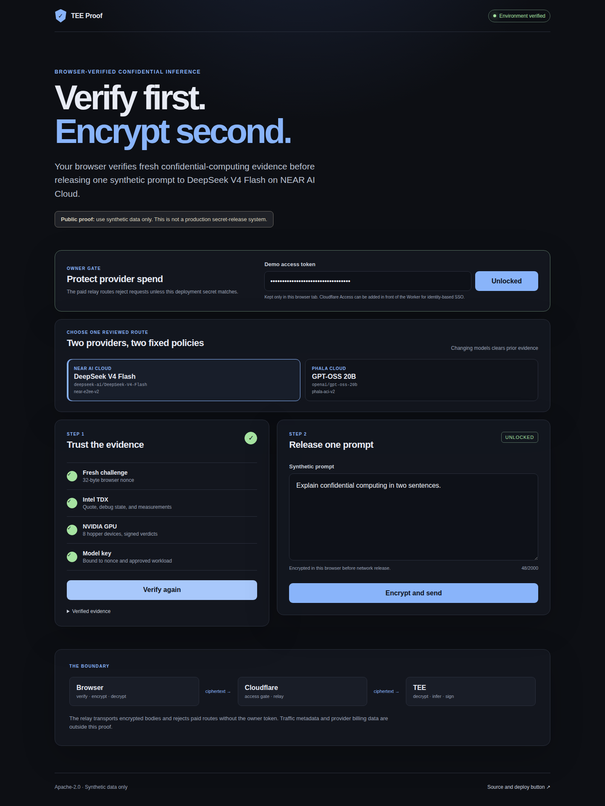
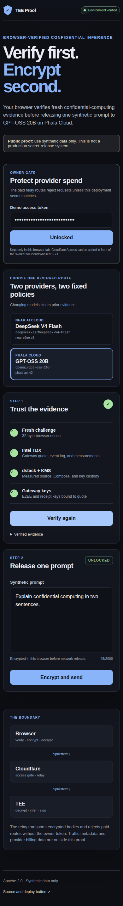

# TEE Proof

A small, browser-verifiable proof of confidential inference across two reviewed provider routes.

[](https://deploy.workers.cloudflare.com/?url=https://github.com/ethanolivertroy/tee-proof-demo)
[](https://github.com/ethanolivertroy/tee-proof-demo/actions/workflows/ci.yml)
[](LICENSE)

## Preview

These are real browser captures from fresh, successful verification runs. No paid model completion was used to make them.

<table>
  <tr>
    <th>NEAR AI Cloud · DeepSeek V4 Flash · desktop</th>
    <th>Phala Cloud · GPT-OSS 20B · mobile</th>
  </tr>
  <tr>
    <td width="70%"></td>
    <td width="30%"></td>
  </tr>
</table>

*The screenshots are illustrative captures. Every live run obtains a new challenge and fresh evidence; expired screenshot timestamps are not reused.*

## What it proves

For one synthetic prompt, the browser:

1. checks a deployment-owner access token before enabling the flow;
2. selects one of two compiled provider/model policies;
3. generates a fresh 32-byte challenge;
4. verifies the selected provider's confidential-computing evidence;
5. encrypts the prompt only after verification succeeds;
6. sends ciphertext through a minimal Cloudflare Worker relay;
7. decrypts the completion in the browser; and
8. authenticates the exact request and response bytes with an attested signing or receipt key.

The Worker hosts static assets, enforces the shared owner gate on provider-billed routes, pins the two upstream origins, bounds request bodies while streaming, and relays ciphertext. **The Worker is not a hardware TEE.**

## Reviewed routes

| Provider | Fixed model | Browser verification | Exact completion authentication |
| --- | --- | --- | --- |
| NEAR AI Cloud | `deepseek-ai/DeepSeek-V4-Flash` | Intel TDX quote, measured workload, eight NVIDIA Hopper GPU verdicts, fresh nonce, and attested model key | Ed25519 signature over `model:SHA256(exact encrypted request bytes):SHA256(exact encrypted response bytes)` |
| Phala Cloud | `openai/gpt-oss-20b` | Intel TDX quote, replayed event log, measured Compose/source commit, dstack KMS custody, fresh nonce, TLS/keyset bindings, and ACI E2EE keys | Signed ACI receipt binding the cleartext request, encrypted wire response, decrypted response, model, endpoint, and verified upstream session |

Changing the model clears prior evidence. There is no caller-selected origin, arbitrary model identifier, general chat history, file upload, tool call, RAG, shell, or code-execution surface.

## Spend protection

A deployed `workers.dev` hostname is publicly reachable by default. This template therefore requires a third secret, `DEMO_ACCESS_TOKEN`, and rejects every provider-billed chat, signature, receipt, and session route unless the browser supplies the matching token.

- Use a unique random value between 20 and 256 characters.
- The browser keeps it in memory for the current tab; it is not written to local storage.
- The Worker removes the token before forwarding to either provider.
- Static assets and attestation endpoints remain public because they do not use the deployer's provider credentials.
- The gate is a shared secret, not identity-aware SSO, rate limiting, or a hard provider spending cap.

For identity-based access, enable [Cloudflare Access on the Worker](https://developers.cloudflare.com/workers/configuration/routing/workers-dev/#manage-access-to-workersdev) after deployment: **Workers & Pages → your Worker → Settings → Domains & Routes → workers.dev → Enable Cloudflare Access**. Keep the built-in owner token as a second control for provider-billed routes. Access is account- and policy-specific, so the repository cannot safely choose or provision the operator's allowed identities through the generic Deploy Button.

## One-click deployment

[](https://deploy.workers.cloudflare.com/?url=https://github.com/ethanolivertroy/tee-proof-demo)

The deployment flow builds the React app, creates a Worker with Static Assets, and prompts for:

| Required secret | Purpose |
| --- | --- |
| `NEAR_AI_API_KEY` | Pays for the fixed NEAR route |
| `PHALA_API_KEY` | Pays for the fixed Phala route |
| `DEMO_ACCESS_TOKEN` | Gates every provider-billed Worker route |

Generate the access token locally, for example:

```sh
openssl rand -hex 32
```

After deployment, open the generated URL and enter the same `DEMO_ACCESS_TOKEN`. Before sharing the URL, enable Cloudflare Access and configure provider-side budgets or limits appropriate to your accounts. This repository does not create a hard spending cap.

## Run locally

Requirements: Node.js 22+, npm, and your own provider keys.

```sh
npm install
cp .dev.vars.example .dev.vars
# Fill in NEAR_AI_API_KEY, PHALA_API_KEY, and DEMO_ACCESS_TOKEN.
npm run dev:worker
```

Open `http://localhost:8787`. Never commit `.dev.vars`.

## Trust flow

```text
Browser                         Cloudflare Worker                    Confidential provider
  |                                      |                                      |
  |-- owner token check ---------------->| validate shared secret               |
  |<------------------------------- 204 --|                                      |
  |                                      |                                      |
  |-- fresh nonce + policy ------------->| fixed attestation origin ----------->|
  |<------------------------- evidence ---|<-------------------------------------|
  |                                      |                                      |
  | verify quote, freshness, policy, keys, measured source, and GPU evidence    |
  | FAIL CLOSED on stale, malformed, debug, substituted, or unapproved evidence |
  |                                      |                                      |
  | encrypt synthetic prompt             |                                      |
  |-- access token + ciphertext -------->| validate gate, shape, size, origin   |
  |                                      |-- provider key + ciphertext -------->|
  |                                      |<----- encrypted completion + proof --|
  |<----------- encrypted response ------|                                      |
  | decrypt + authenticate exact bytes   |                                      |
```

## Fail-closed properties

- Fresh random nonce for every verification attempt.
- Five-minute local evidence cap, even if provider evidence lives longer.
- Exact, compiled endpoint and model allowlist.
- Intel TDX collateral verification and debug-mode rejection.
- NEAR workload measurements and exact eight-GPU NVIDIA signed-verdict policy.
- Phala workload ID, measurements, measured Compose hash, measured source commit, KMS custody, E2EE key, receipt key, and TLS binding.
- Browser worker isolation for expensive quote verification.
- Prompt release disabled until the selected policy verifies.
- Evidence invalidated on model changes or expiry.
- Exact completion bytes authenticated after browser decryption.
- Strict response schemas reject unknown or plaintext-bearing metadata.
- Worker body limits apply even without `Content-Length`; oversized streams are cancelled as soon as the cap is crossed.
- Access token checked before provider credentials or paid upstream routes are used.
- Provider credentials remain Worker secrets and are never sent to the browser.

## Important limits

Use synthetic data only.

This proof does **not** establish:

- approval for regulated or sensitive production data;
- safety for arbitrary workloads or user-selected models;
- a complete production secret-release design;
- identity-aware authorization without enabling Cloudflare Access;
- a hard spending cap or guaranteed provider availability;
- hidden IP addresses, timing, ciphertext length, or other traffic metadata;
- elimination of provider, Intel, NVIDIA, certificate-authority, Cloudflare, or code-review trust; or
- that Cloudflare Workers themselves execute inside the demonstrated hardware TEE.

Phala and NEAR measurements can legitimately change after reviewed deployments. This demo fails closed until the new evidence and measured source are requalified and the compiled policy is updated.

## Validation

```sh
npm run check
npm run deploy -- --dry-run
npm audit --omit=dev --audit-level=moderate
```

The committed screenshots were captured at `1440×1000` and `390×844` viewports after successful live attestation verification. The full-page PNG dimensions are larger because the page scrolls vertically.

No Cloudflare Worker or paid confidential-model completion was deployed or invoked while validating this repository.

## Project map

```text
src/App.tsx                         fixed two-provider proof UI and owner gate
src/lib/policy.ts                  compiled provider/model/measurement policies
src/lib/attestation.ts             NEAR Intel TDX + NVIDIA verification flow
src/lib/phala-verifier-core.ts     Phala TDX, dstack, KMS, key, and source checks
src/lib/phala-aci/                 Phala ACI binding, E2EE, and receipt primitives
src/lib/crypto.ts                  browser E2EE and Ed25519 response verification
worker/index.ts                    gated, origin-pinned ciphertext relay
public/_headers                    browser security headers
docs/screenshots/                  committed desktop and mobile previews
tests/                             crypto, Worker, protocol, and Phala hardening tests
```

See [SECURITY.md](SECURITY.md) for reporting instructions and the current dependency note.

## License

Apache-2.0. See [LICENSE](LICENSE).
